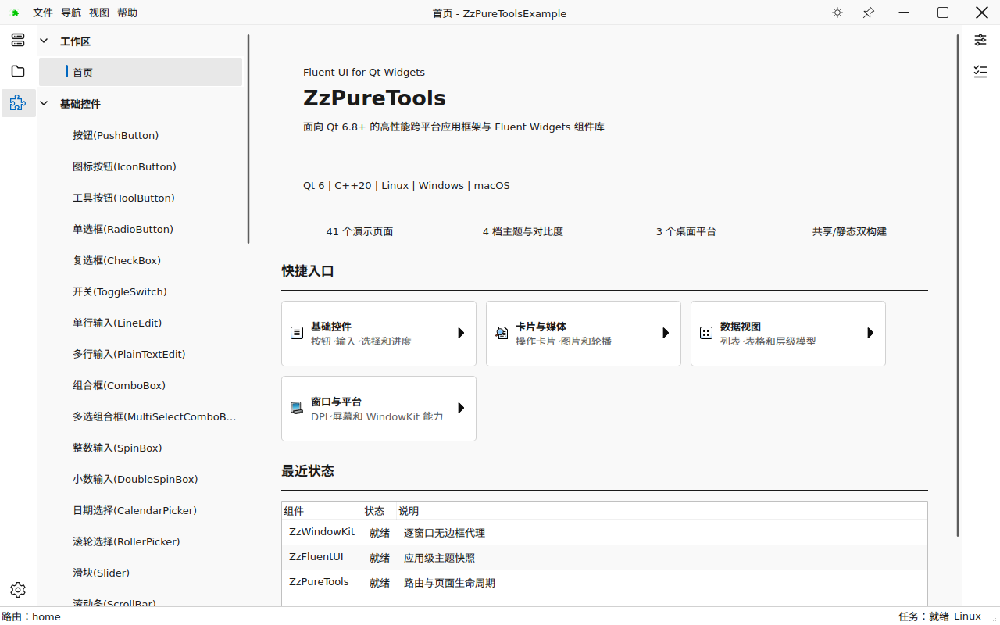

# ZzPureToolsFrame

[](https://github.com/jackfahdin/ZzPureTools/actions/workflows/ci.yml)


[](LICENSE)

面向 **Qt Widgets 桌面应用**的 Fluent 组件库与应用框架。
从主题、输入控件到导航、多窗口和工作区，提供可组合的 C++20 接口。

[📦 下载示例](https://github.com/jackfahdin/ZzPureTools/releases/tag/continuous-build) ·
[🚀 快速开始](#-快速开始) ·
[🧩 组件与模块](#-组件与模块) ·
[🧪 质量状态](#-质量状态) ·
[📚 开发资料](#-开发资料)

<picture>
  <source media="(prefers-color-scheme: dark)" srcset="examples/ZzPureToolsExample/tests/baselines/linux/qt-6.11/dpr-100/dark.png">
  
</picture>

<sub>仓库中的真实示例截图 · Linux / Qt 6.11 · 同时支持浅色、深色与高对比主题。</sub>

当前版本 `0.1.0`，仍处于开发阶段。目标平台为 Linux、Windows 和 macOS；
自动构建、性能门禁与真实桌面验收分别记录，详见下方质量状态。

## 📦 下载示例

[continuous-build 预发布页（Pre-release）](https://github.com/jackfahdin/ZzPureTools/releases/tag/continuous-build)
提供五个平台的桌面示例。只有同一提交的完整构建、CTest、部署检查与启动 smoke
全部通过，下载页才会整体更新；下载包可能落后于 `master`。

| 平台 | 下载包 |
|---|---|
| 🐧 Linux · Ubuntu 22.04 x86_64 | [AppImage](https://github.com/jackfahdin/ZzPureTools/releases/download/continuous-build/ZzPureToolsExample-continuous-linux-x86_64.AppImage) |
| 🪟 Windows · MSVC 2022 x86_64 | [ZIP](https://github.com/jackfahdin/ZzPureTools/releases/download/continuous-build/ZzPureToolsExample-continuous-windows-msvc2022-x86_64.zip) |
| 🪟 Windows · Qt MinGW x86_64 | [ZIP](https://github.com/jackfahdin/ZzPureTools/releases/download/continuous-build/ZzPureToolsExample-continuous-windows-mingw-x86_64.zip) |
| 🍎 macOS · Apple Silicon | [DMG](https://github.com/jackfahdin/ZzPureTools/releases/download/continuous-build/ZzPureToolsExample-continuous-macos-arm64.dmg) |
| 🍎 macOS · Intel | [DMG](https://github.com/jackfahdin/ZzPureTools/releases/download/continuous-build/ZzPureToolsExample-continuous-macos-x86_64.dmg) |

这些产物是未签名的开发预览。每个包均附 SHA-256 校验文件（`.sha256`）与 `.build-info.json`，
用于核对完整性和源码提交。MSVC 与 MinGW 的 Qt、工具链和库文件须分别使用。

## 🧩 组件与模块

| 能力 | 主要组件与入口 |
|---|---|
| 🎨 主题与标准控件 | 浅色 / 深色 / 高对比、主题令牌、局部强调色；`ZzFluentStyle` 统一原生 Qt Widgets 外观 |
| ⌨️ 输入与选择 | 密码框、快捷键录入、建议框、多选下拉、滚轮、日历、颜色选择器、评分、范围滑块 |
| 🧭 导航与内容 | 导航视图与树、面包屑、TabBar / TabWidget、Pivot、轮播图、展开区和抽屉 |
| 💬 反馈与表面 | 信息栏、徽标、内容对话框、教学提示、操作卡片与图像卡片 |
| 📊 动画与仪表 | 环形进度、边框光束、音频电平表、径向仪表、水波进度球、时间轴 |
| 🗂️ 应用工作区 | 页面路由、侧面板、分屏、多窗口撕出、关闭守卫、布局保存与恢复 |

`QListView`、`QTableView`、`QTreeView` 等标准控件保留 Qt 的模型、选择、键盘、
RTL 和无障碍语义，由样式与委托提供 Fluent 外观。无需为每个标准控件增加同义包装。
命令切换使用 `ZzPushButton::setCheckable(true)`，开关轨道使用 `ZzToggleSwitch`。

四个模块、六个导出目标，可按需要选择依赖：

| 模块 | CMake 目标 | 职责 |
|---|---|---|
| `ZzCore` | `Zz::Core` | 错误与结果、应用路径、设置、可取消任务、日志桥接 |
| `ZzWindowKit` | `Zz::WindowKit` | QWindowKit 私有适配、无边框窗口状态管理 |
| `ZzFluentUI` | `Zz::FluentFoundation`、`Zz::FluentUI` | 主题令牌、样式、绘制原语与 Widgets 组件 |
| `ZzPureTools` | `Zz::AppCore`、`Zz::PureTools` | 模块生命周期、路由、页面、导航与应用装配 |

UI 组件不直接访问业务服务、数据库或网络客户端；QWindowKit 类型不进入 Zz 公共 API。
中央区域默认采用[无标签堆叠页面](docs/development/STACKED_WORKSPACE_ZH.md)，
需要多标签时可嵌入 `ZzTabWidget` 或分屏工作区。
详细约定见[架构设计](docs/superpowers/specs/2026-08-02-zzpuretoolsframe-architecture-design.md)
和[工作区公共 API](docs/development/WORKSPACE_API_ZH.md)。

## 🚀 快速开始

需要 CMake 3.23+、Ninja、Qt 6.8+（Core、Gui、Widgets、Svg、Concurrent；测试还需 Test）
以及支持 C++20 的工具链。Linux 使用 GCC 13.1+ 或 Clang 17+；Windows 使用
MSVC x64 或与 Qt kit 匹配的官方 MinGW；macOS 使用 Apple Clang 15+。
项目仅支持 Qt 6，默认构建共享库。

<details open>
<summary><strong>Linux · GCC</strong></summary>

将环境变量替换为本机 SDK 和编译器路径：

```bash
export QT_ROOT=/path/to/Qt/6.x/gcc_64
export GCC_13=/path/to/gcc
export GXX_13=/path/to/g++

cmake --preset linux-gcc-debug \
  -DZZ_BUILD_EXAMPLES=ON -DCMAKE_BUILD_WITH_INSTALL_RPATH=OFF
cmake --build --preset linux-gcc-debug --parallel
ctest --preset linux-gcc-debug --output-on-failure
```

需要安装库时执行：

```bash
cmake --install build/linux-gcc-debug --prefix install/linux-gcc-debug
```

</details>

<details>
<summary><strong>Windows · MSVC</strong></summary>

在 Visual Studio 的 **x64 Developer PowerShell** 中运行，确认 `cl.exe` 和 Ninja 可用：

```powershell
$env:QT_MSVC_ROOT = 'D:/Qt/6.x/msvc2022_64'

cmake --preset windows-msvc2022-release -DZZ_BUILD_EXAMPLES=ON
cmake --build --preset windows-msvc2022-release --parallel
ctest --preset windows-msvc2022-release -C Release --output-on-failure
```

`windows-msvc2022-release` 使用 Ninja，实际编译器来自当前开发者终端；
本地也可使用 VS 2026。MSVC 示例输出位于 `build/windows-msvc2022-release/bin/`。
静态预设使用 VS 2026 / CMake 4.2+，与持续发布的 VS 2022 配置分开。

</details>

性能参考报告现已补齐，本机验证与平台限制见[质量状态](#-质量状态)。
更多平台、静态库、LTO、clang-tidy 与 sanitizer 配置见
[构建手册](docs/development/BUILDING_ZH.md)。本机路径请放在环境变量或不入库的
`CMakeUserPresets.json` 中，参考[本机配置示例](CMakeUserPresets.json.example)。

### 在自己的项目中使用

安装框架后，复制 [`ZzApplicationStarter`](examples/ZzApplicationStarter/) 到自己的工程目录，
通过 `find_package(ZzPureToolsFrame 0.1 CONFIG REQUIRED)` 接入即可。
Starter 演示统一标题栏、内嵌字体图标、主题保存与恢复、多窗口和关于窗口；
它使用公开安装包，无需复制完整 Example 的业务代码。

Qt kit、编译器、架构和构建类型须与已安装框架匹配。
[接入指南](docs/development/FRAMEWORK_INTEGRATION_ZH.md#从可运行的起步工程开始)
提供独立构建命令、运行库路径、smoke 验证和窗口所有权说明。

标题栏按钮支持逐个显示或隐藏，隐藏后自动释放布局空间：

```cpp
using Button = ZzFluentUI::ZzFluentTitleBar::Button;
auto *bar = window.titleBar();

bar->setButtonVisible(Button::Maximize, false);    // 隐藏最大化/还原
bar->setButtonVisible(Button::Theme, false);       // 隐藏主题切换
bar->setButtonVisible(Button::AlwaysOnTop, false); // 隐藏置顶
bar->setButtonVisible(Button::Maximize);           // 默认 true，重新显示
```

五个自绘按钮（`Minimize`、`Maximize`、`Close`、`AlwaysOnTop`、`Theme`）
初始配置均为显示，可通过 `isButtonVisible(Button::Close)` 查询。
隐藏按钮不改变窗口能力、主题或置顶状态；macOS 原生系统按钮由宿主平台策略管理。

## 🖥️ 示例入口

| 示例 | 适合了解 |
|---|---|
| `ZzApplicationStarter` | 新项目起点：独立安装包消费、标题栏、主题持久化、多窗口和辅助窗口 |
| `ZzPureToolsExample` | 完整桌面应用：组件演示、双向导航、工作区、多窗口与关闭守卫 |
| `ZzFluentControlsGallery` | 控件交互、主题与标准表面 |
| `ZzFluentFoundationDemo` | 主题快照与基础令牌 |
| `ZzWindowKitDemo` | 无边框窗口、标题栏命中区域与窗口控制 |
| `ZzPureToolsDemo` | 模块注册、页面路由与基础应用装配 |

新应用推荐从[独立 Starter](examples/ZzApplicationStarter/main.cpp)入手；
[最小应用装配](examples/ZzPureToolsDemo/main.cpp)和
[综合应用入口](examples/ZzPureToolsExample/main.cpp)可用于了解更多框架能力。
多窗口与拓扑恢复的接入方式见
[通用应用接入指南](docs/development/FRAMEWORK_INTEGRATION_ZH.md)。

## 🧪 质量状态

CTest 覆盖单元测试、公共头独立编译、架构边界、安装消费、包重定位、
二进制依赖、截图和发布契约。托管 CI 包含 Linux、Windows MSVC、Windows MinGW、
macOS arm64 与 macOS x86_64。CI smoke 不等于真机验收；
启动检查与真实桌面交互验收分别记录。

**2026-10-12 本机验证快照：**

| 检查 | 已验证的状态 |
|---|---|
| ✅ 框架回归 | 外置 Qt 6.11.1 精度修复 SDK / GCC 15.2 / Release + LTO：263/263 非性能测试通过；文档与性能脚本契约另行通过 |
| ✅ 安装包接入 | 安装消费、公共头、包重定位和动态依赖检查通过 |
| ✅ Qt 定时修复 | 独立完整构建 SDK，正常链接；Qt 原生 7/7 CTest、498 项检查通过，2 项 Windows 专用检查跳过 |
| ✅ 性能验收 | 独立最终运行 55/55 CTest、26 项绝对门禁、16/16 场景相对比较通过 |
| ✅ 完整参考基线 | 新环境的 16 份同源报告已启用；旧 Mesa 26.0.3 档案、12 份报告和门限原样归档 |
| ✅ 启动探针 | 修复首帧早于焦点到达的竞态；真实 XCB 启动与就绪检查各连续 30 轮通过 |
| ✅ CI 回归 | 维护者于 2026-10-13 确认 [`e9fc1e9`](https://github.com/jackfahdin/ZzPureTools/commit/e9fc1e91e7318ad654fc2047a84b2beb7c0b0a09) 的矩阵全绿；此前缺参考、生命周期及布局增长问题已合入修复 |
| 📦 历史成功发布 | [`a9396b1`](https://github.com/jackfahdin/ZzPureTools/actions/runs/38049701780) 完整矩阵成功，发布五个平台示例；不代表当前提交状态 |
| ⏳ 真实桌面验收 | Windows、macOS 与 Linux 显示/系统集成仍按平台清单验证 |

性能通过依赖[独立精度修复 SDK](docs/performance/evidence/qt-precision-sdk/2026-10-12/README.md)，
原安装 Qt SDK 没有被修改；该性能基线 SDK 不含 QtMultimedia，音频专项见下方独立验证。
动画仍执行 16.7 ms 预算，布局增长仍限制 20 倍。
Tab 状态和侧栏活动激活的相对 P95 经多轮校准改为观察，各增加 1 ms 绝对预算；
预算内的百分比退化仍会记录，但不阻断。

本轮修复与报告已分项提交并合并到 `master`。上表记录本机验证证据，
远端矩阵状态以对应提交的 CI 结果为准；macOS 原生销毁行为仍需对应平台复核。
[迁移与完整原始证据](docs/performance/evidence/reference-migration/2026-10-12/README.md)
保留了中途失败、校准依据和最终独立验收；
[CI 与性能复核](docs/performance/CI_PERFORMANCE_REVIEW_2026-10-12_ZH.md)
记录问题与平台边界，[修复计划](docs/superpowers/plans/2026-10-12-ci-runtime-repairs.md)
记录执行结果。

**2026-10-13 独立 SDK 与音频补充验证：**

| 检查 | 结果 |
|---|---|
| 🛠️ 可复现构建入口 | 锁定 Qt 6.11.1 官方源码和补丁摘要；五模块 SDK 从头构建成功，同配方重跑无需重新编译 |
| ✅ 原生定时测试 | 新 SDK 上 7/7 CTest、498 个检查通过；2 个 Windows 专用检查跳过 |
| 🎵 真实音频解码 | FFmpeg / PulseAudio 配置，3/3 音频测试、13 个检查通过，0 跳过；覆盖双声道电平、隐藏暂停和模拟切换 |
| 🔎 防误判检查 | 拒绝覆盖未知安装、坏源码缓存、错误 Qt 运行库及播放用例跳过；三项脚本契约通过 |

使用方式见 [Qt SDK 构建与验证指南](docs/performance/QT_PRECISION_SDK_ZH.md)，
完整记录见 [SDK 与音频验证证据](docs/performance/evidence/qt-sdk-reproducible/2026-10-13/README.md)。
新 SDK 尚未迁移为活动性能基线；本轮新增工具仅完成本机验证。
音频测试采用生成的 WAV 静音解码，不替代声卡、麦克风和蓝牙设备的人工验收。

## 📚 开发资料

| 主题 | 文档 |
|---|---|
| 入门与协作 | [构建手册](docs/development/BUILDING_ZH.md) · [编码规范](docs/development/CODING_STANDARD_ZH.md) · [GitHub Actions](docs/development/GITHUB_ACTIONS_ZH.md) |
| 应用架构 | [接入指南](docs/development/FRAMEWORK_INTEGRATION_ZH.md) · [工作区 API](docs/development/WORKSPACE_API_ZH.md) · [平台状态](docs/development/PLATFORM_SUPPORT_ZH.md) |
| 外观与资源 | [局部强调色](docs/development/CONTROL_ACCENT_ZH.md) · [侧面板外观](docs/development/SIDE_PANEL_APPEARANCE_ZH.md) · [图标来源](docs/development/ICON_ASSETS_ZH.md) |
| 控件细节 | [范围滑块](docs/development/RANGE_SLIDER_ZH.md) · [环形进度](docs/development/PROGRESS_RING_ZH.md) · [数值输入布局](docs/development/SPIN_BOX_LAYOUTS_ZH.md) · [滑块提示](docs/development/SLIDER_VALUE_TIP_ZH.md) · [进度条外观](docs/development/PROGRESS_BAR_APPEARANCE_ZH.md) · [分组框](docs/development/GROUP_BOX_ZH.md) |
| 性能 | [基线与测量规则](docs/performance/PERFORMANCE_BASELINE_ZH.md) · [本次复核](docs/performance/CI_PERFORMANCE_REVIEW_2026-10-12_ZH.md) |
| 人工验收 | [Windows](docs/release/MANUAL_WINDOWS_CHECKLIST_ZH.md) · [macOS](docs/release/MANUAL_MACOS_CHECKLIST_ZH.md) · [Linux](docs/release/MANUAL_LINUX_CHECKLIST_ZH.md) |
| 发布合规 | [第三方通知](docs/third-party/THIRD_PARTY_NOTICES.md) · [发布阻断项](docs/third-party/RELEASE_BLOCKERS_ZH.md) |

## 许可证

ZzPureToolsFrame 采用 [MIT License](LICENSE)，版权所有者为 Jackfahdin。
第三方组件适用各自许可证，来源、版本与安装通知见
[第三方软件通知](docs/third-party/THIRD_PARTY_NOTICES.md)。
