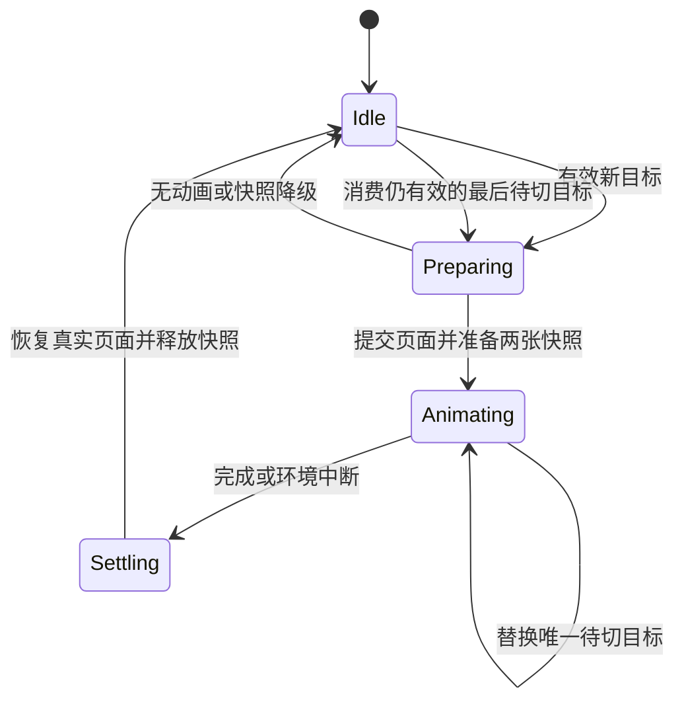

# 带动画的页面容器设计

**状态：** 供审阅的设计草案；本轮仅形成计划，不表示组件已实现。

**核对基点：** `cd41d79`，Qt 6.8+、C++20、Linux 优先，Windows／macOS 保留原生验收。

**目标：** 提供可独立安装和复用的 `ZzFluentUI::ZzAnimatedStackedWidget`，
承载应用已创建的 QWidget 页面，并为页面切换提供有界动效。

## 1. 现有代码与范围

| 代码 | 已有职责 | 本次关系 |
| --- | --- | --- |
| `ZzPureTools/widgets/src/private/ZzPageHostPrivate.cpp` | factory、事务式激活、WhileActive 销毁和 Recreatable LRU | 首版不改变其生命周期；后续接入必须在旧页销毁前取得图像 |
| `ZzPureTools/widgets/include/ZzPureTools/ZzWorkspaceShell.h` | 公开 `QStackedWidget *stackWidget()` | 首版不替换公开类型，不能假设 Qt 非虚切页方法可被子类完整拦截 |
| `ZzFluentUI/widgets/include/ZzFluentUI/ZzPanelStack.h` | 纵向分割、多面板独立显隐 | 与单页切换职责不同，继续保留 |
| `examples/ZzPureToolsExample/ZzExampleTabBarsPage.cpp` | 局部 `ZzVerticalPageStack`，两张快照、每次创建动画组 | 首个实际接入点；组件完成后删除这份重复实现 |
| `ZzFluentUI/widgets/src/private/ZzWidgetTheme.h` | Fluent 主题与普通样式回退快照 | 复用主题绑定 |
| `ZzFluentUI/foundation/include/ZzFluentUI/ZzAnimationPolicy.h` | 统一动效时长与减少动态效果 | 页面动效按非必要动画处理 |
| `ZzFluentUI/foundation/include/ZzFluentUI/ZzMotionToken.h` | 已有 `PageTransition` token | 默认时长直接读取，不新增硬编码默认值 |

上游对照为 `FluentUIStyle/ExWidgets/controls/exstackedwidget.{h,cpp}`，
核对版本 `fb227d1808b2340262fbce2d9521ea070e30b384`。
借鉴快照滑动及只保留最后待切请求；独立实现 DPR、RTL、对象生命周期和资源上限。
不修改或复制覆盖上游源码。

首版包含独立库组件、测试、标签示例接入、SDK 消费和使用文档。
不包含路由、页面 factory、业务数据、缓存淘汰、手势拖动、循环轮播、异步加载，
也不默认开启整个工作区或 `ZzPageHost` 的动画。Tour 和 TimerDial 不属于本计划。

## 2. 方案比较

| 方案 | 优点 | 代价与风险 | 决定 |
| --- | --- | --- | --- |
| QWidget 组合页面布局与快照覆盖层 | API 完整受控，绘制不改变页面实际几何，能限制资源 | 需要定义独立页面接口与输入策略 | **采用** |
| 继承 QStackedWidget 并隐藏 setCurrentIndex | 示例替换量小 | 基类指针和非虚方法会绕过动画；容易出现两套切换语义 | 不作为公开组件方案 |
| 直接移动或改变真实页面透明度 | 无整页截图，动态内容持续刷新 | 布局、焦点、原生窗口和图形效果相互影响 | 首版不采用 |

四文件 Pimpl 保持与项目一致；覆盖层是私有实现，不增加对业务模块或 Qt 私有 API 的依赖。

## 3. 公开接口草案

以下声明位于 `ZzFluentUI/widgets/include/ZzFluentUI/ZzAnimatedStackedWidget.h`。
完整实现需补充中文 Doxygen、导出宏、Q_OBJECT、Q_ENUM 和 Pimpl，不能将这些声明
当作已存在的 SDK 接口。类型均处于单一 `ZzFluentUI` 命名空间。

```cpp
class ZzAnimatedStackedWidget final : public QWidget
{
public:
    enum class ZzTransitionMode { None, SlideHorizontal, SlideVertical, Fade };
    enum class ZzTransitionDirection { Automatic, Forward, Backward };

    explicit ZzAnimatedStackedWidget(QWidget *parent = nullptr);
    ~ZzAnimatedStackedWidget() override;

    int count() const noexcept;
    QWidget *widget(int index) const noexcept;
    int indexOf(QWidget *page) const noexcept;
    int currentIndex() const noexcept;
    QWidget *currentWidget() const noexcept;
    int addWidget(QWidget *page);
    int insertWidget(int index, QWidget *page);
    QWidget *takeWidget(QWidget *page);

    bool setCurrentIndex(int index,
        ZzTransitionDirection direction = ZzTransitionDirection::Automatic);
    bool setCurrentWidget(QWidget *page,
        ZzTransitionDirection direction = ZzTransitionDirection::Automatic);
    ZzTransitionMode transitionMode() const noexcept;
    void setTransitionMode(ZzTransitionMode mode);
    int duration() const noexcept;
    void setDuration(int milliseconds);
    bool isTransitionRunning() const noexcept;
    bool setPageAnimationEnabled(QWidget *page, bool enabled);
    bool isPageAnimationEnabled(QWidget *page) const noexcept;

Q_SIGNALS:
    void currentChanged(int index);
    void countChanged(int count);
    void transitionStarted();
    void transitionFinished();
};
```

- 默认模式 `SlideHorizontal`；默认 `duration() == -1`，表示读取主题 `PageTransition`。
  显式时长裁剪到 `[-1, 10000]`，零为无动画，再经
  `ZzAnimationPolicy::adjustedDuration(value, reducedMotion, false)` 调整。
- 无效模式／方向枚举拒绝设置；无效索引、空指针或未注册页返回失败且不改变状态。
  `widget()` 越界返回 nullptr，`indexOf()` 未注册返回 -1。
- `addWidget`／`insertWidget` 只接受 GUI 线程中的无父对象页，或父对象正是本容器的页。
  拒绝容器本身、祖先、其他容器拥有的页和跨线程页；失败不改变所有权。
  插入索引合法范围为 `[0, count()]`；重复添加返回原索引，不隐式移动。
- 注册后容器拥有页面；`takeWidget` 隐藏并解除 parent 后归还，绝不主动删除页面。
  页面在同步回调中已被销毁时返回 nullptr。容器析构删除仍拥有的页。
- 首个页面立即成为当前页，不播放动画；空容器当前索引为 -1。
  移除当前页时选择同位置的后继页，没有后继则前驱，最后一页移除后为空。
  这些结构变更直接提交，不播放退场动画。
- 插入／移除导致当前索引变化时发出一次 `currentChanged`，即使页面身份未变。
  页面身份通过 QPointer 维护，不能用旧索引代表运行中或排队中的目标。
- 直接删除或从外部重新设置已注册页的 parent，必须同步清理注册记录与待切引用；
  不能重新夺回调用者已移走的页面。
- 首版只接受 GUI 线程调用，不承诺跨线程 getter／setter；文档明确调用约束。

## 4. 切换语义与状态机

`currentWidget()` 表示已经逻辑提交的页面，不能让路由或业务等待动画结束才改变状态。
动画显示的是两个瞬时快照，真实目标页在结束时恢复展示。
`setCurrentIndex` 返回 true 表示请求有效并已提交或被合并排队，不表示动效已结束。



### 正常提交

1. 校验目标并保存源页、目标页、焦点和操作代次；先决定是否需要动效。
2. 只在确实会动画时捕获旧页；提交内部当前页，完成目标布局后捕获目标页。
   任何 QWidget 事件、render、显隐或焦点操作后都重新验证 QPointer 和操作代次。
3. 先安装一致的内部状态，再发 `currentChanged`；接收者可能删除容器、移除页面或再次切页。
   若操作仍有效，发 `transitionStarted`，启动同一个 QVariantAnimation。
4. 结束时先恢复真实页、释放图像、清除 running 状态，再发 `transitionFinished`。
   信号之后不得无条件访问对象；所有同步重入都应有回归测试。
5. 无动画路径只发实际变化的 `currentChanged`，不发 started／finished。
   每次真实 started 在容器仍存活时对应一次 finished，包括环境中断后的收敛。

### 连续请求

- A→B 动画期间请求 C、D：不打断当前画面，只保留 D；B 完成后开始 B→D。
  current 在第一段是 B，D 开始时才成为 D。
- 期间再次请求 B：清空待切目标。请求 A：待切目标为 A，完成后正常反向切换。
- 无效请求不覆盖已有有效待切目标。待切页被删除／移走时清空待切目标。
- 源页或当前目标被删除／take／移走时，立即结束本段并清空 pending：
  目标仍存活则保留目标，否则按第 3 节的后继／前驱规则选页。
  只移除独立的 pending 页时不打断正在播放的段；插入或移除其他页只更新索引，
  不改变已开始段的方向，也不把旧索引当成新目标。
- started／currentChanged 回调内的请求同样合并；finished 回调内的新请求优先于此前排队值。
  用单调 operationGeneration 防止结束回调之后又执行陈旧请求。
- 没有 FIFO 队列，没有每次请求新建动画。最新有效目标在当前段结束后开始，
  连续输入停止后的等待上界为当前剩余时长加一段新动画时长，不包含不可控页面绘制耗时。

## 5. 绘制、方向、输入与可访问性

- 私有结构：一个真实内容宿主及 QStackedLayout，一个覆盖层、一个 QVariantAnimation。
  内容宿主与覆盖层作为兄弟对象；动画时隐藏真实宿主并保留布局尺寸，
  结束后恢复宿主。不能把覆盖层放在被隐藏的宿主下面。
- 覆盖层由私有 `ZzStackTransitionOverlay` 自绘两张 `QImage::Format_ARGB32_Premultiplied`，
  不使用两个 QLabel、QGraphicsOpacityEffect、动画组或每帧页面 render。
  图像填充当前容器背景后合成页面，透明子控件应按最终背景呈现。
- 像素尺寸为 `ceil(logicalWidth * dpr)`、`ceil(logicalHeight * dpr)`；设置图像 DPR，
  QWidget render 与 QPainter 坐标统一使用逻辑单位，避免重复缩放。
  偏移以内容区域原点为基准，覆盖非零 contentsMargins。
- 横向 Automatic 按目标与源当前顺序决定前进／后退，再按 RTL 镜像。
  Forward：LTR 从右进入，RTL 从左进入；Backward 相反。
  纵向 Forward 从下进入、Backward 从上进入，不受 RTL 改变。
  Fade 忽略方向，先画完整旧图，再以进度作为新图不透明度合成，防止中段背景透出。
- 使用 OutCubic。主题、尺寸、DPR、语言、布局方向变化时停止旧快照，
  直接收敛到最后有效请求；窗口隐藏、禁用或失活同样清理。
  修改模式、时长或关闭当前涉及页面的动画时立即收敛，不在旧参数上继续播放。
- 覆盖层截获自身区域的鼠标、触摸与滚轮；真实宿主隐藏，不能向不可见按钮穿透输入。
  不修改页面原 enabled 状态，也不截获其他窗口或外部导航的事件。
- 仅当焦点原先位于离开的页内，才临时移到容器；结束后恢复目标页最近有效焦点，
  没有则转到目标页首个可聚焦子项，仍没有则留在容器。
  如果用户期间主动把焦点移到外部控件，不抢回；目标被删除、隐藏或禁用也不强制聚焦。
- 动画期间快照不形成第二套可访问页面树；真实宿主暂时不可见，覆盖层不暴露为内容页。
  容器保持可聚焦且命名，结束后恢复真实页面的可访问结构。无动画路径无额外焦点跳转。
  全局应用快捷键仍由应用处理；页面只在真实可见时接收其窗口上下文输入。

## 6. 降级规则

以下情况直接切换，不捕获图像：模式 None、时长零、减少动态效果、首次显示、
容器隐藏、内容区域为空、任一端明确禁用动画、资源预算检查失败。
捕获失败或捕获过程中发生删除／重入时释放已分配图像并进入一致的真实页面状态。

对可识别的 `QOpenGLWidget`、`QQuickWidget`、`QVideoWidget`、原生子窗口
及窗口容器子树保守降级；使用 QObject 类型继承信息和原生窗口属性检查，
不为了检测而创建 winId，不引入 Qt Multimedia／Quick／OpenGLWidgets 强制链接依赖。
自动检测不可能覆盖所有第三方渲染器；必须提供 `setPageAnimationEnabled(page, false)`，
视频等动态页面由应用显式关闭，不能宣传“所有 QWidget 都可准确截图”。

添加含上述类型的可选原生验证时，有对应 Qt 模块才编译专项测试；
标准 Qt Widgets SDK 和基础安装消费者仍可独立构建。

## 7. 资源与性能预算

| 项目 | 首版约束／目标 | 验证方式 |
| --- | --- | --- |
| 动画对象 | 组件自身创建至多 1 个，停止后无周期性更新；不计业务页自有动画 | 反复切换 1,000 次并统计组件拥有的 QObject 与 Paint |
| 活跃图像 | 最多 2 张；结束／隐藏／删除后保留字节数为 0 | 私有状态测试，不提供生产版测试 getter |
| 图像预算 | 两张 ARGB 图像总计不超过 64 MiB | 分配前检查整数溢出与行字节数，超出直接降级 |
| 待切请求 | 最多 1 个 QPointer 与方向值 | 100 个连续目标只消费最后一个 |
| 每帧工作 | 只更新进度和绘图，不创建 QObject、不 render 页面、不重建布局 | 页面 paint 计数与分配／对象观察 |
| 页面截图 | 每段至多源／目标各 1 次；无动画路径为 0 次 | 对页面 render 事件进行独立计数 |
| 参考捕获耗时 | 两页准备时间 p95 目标 ≤16.7 ms | 固定 1280×720 QWidget 表单，DPR 1/1.5/2，各预热 10 次、采样 100 次 |
| 参考绘制耗时 | 覆盖层 Paint CPU 时间 p95 目标 ≤8 ms | 同一固定场景；不把该数值等同于系统合成帧率 |

64 MiB 仅约束组件拥有的图像存储，不承诺 Qt 后端缓存或整个进程 RSS 上限。
两张 3840×2160 ARGB 图像约 63.3 MiB，可覆盖 1920×1080／DPR 2；更大尺寸直接降级。
资源数量与释放是确定性硬门禁。耗时为需要实测的设计目标，首轮使用现有性能报告
schema 记录三轮环境指纹，不擅自新增或重建历史相对性能基线。
若参考场景超目标，先优化并复测；仍不能满足时在验收记录中明确阻塞及取舍，
不能通过调整旧门限或将快照成本计到采样区间之外来宣称达标。

## 8. 首个实际接入与框架后续阶段

首版将 `ZzExampleTabBarsPage.cpp` 的 `ZzVerticalPageStack` 替换为库组件，设置
SlideVertical，保持 `zzExampleNavigationPages`、五个页面名称、布局和最终外观。
原 `switchTo(index)` 改为调用组件 `setCurrentIndex(index)`；示例创建页面时使用
无父对象或本容器父对象，遵守明确的所有权入口。
模式和边界验证放在组件测试中，首版不增加一套新的示例导航或业务模型。

框架级接入是首版验收后的独立设计阶段，必须同时解决以下三项才允许实施：

1. `ZzWorkspaceShell::stackWidget()` 既有 Qt 类型的兼容方案，不能强制调用方改用新类型。
2. `ZzPageHostPrivate::activate()` 在 WhileActive 析构前捕获旧页，但 factory 失败时
   维持原页面、路由、缓存和可见状态；快照不延长 Presenter／ViewModel 生命周期。
3. 中央工作区和页面宿主只选择一层播放，避免嵌套双重截图；默认行为和开关写入独立契约。

本阶段交付文档指出这些接入点，不提前修改框架公共接口或重构路由系统。

## 9. 验收与交付

- Qt 6.8.3 Release 与 Qt 6.11.1 Debug：单元、主题、RTL、DPR、无障碍及示例接入通过。
- X11/Xvfb：输入隔离、窗口焦点与隐藏恢复通过；Windows／macOS 分别进行原生输入、
  焦点、DPR／屏幕变化及 GPU／视频页面降级验收，明确区分已验证与未验证。
- 测试覆盖 started／currentChanged／finished 回调同步删除、切页、take、重设 parent，
  以及 render 内请求新页面；ASan／UBSan 下无悬空访问。
- 公开头、共享／静态 SDK、Development 组件、完整安装和迁移消费者通过。
- 现有截图最终态应保持一致；新动画中间态使用确定性纯色页面像素断言，
  不通过更新旧总览基线或放宽遮罩／门限掩盖回归。
- CI 配置阶段八项契约必须运行，尤其 `platform.gate-script-contract`，
  增加构建路径时同步嵌套构建次数与并行度限制。
- 当前工作流：本地 master、线性小提交，文档最后提交，不创建分支、不推送、
  不访问 `docs/research`，不改第三方源码。用户当前授权仅为编写本设计和计划。
